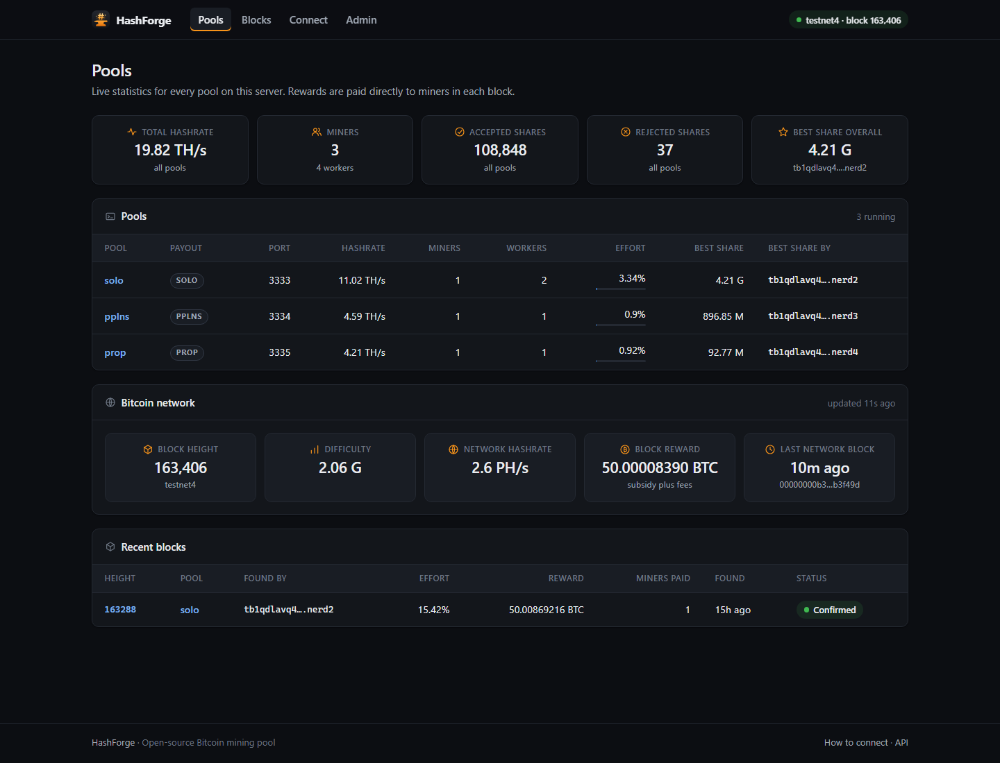

# HashForge

[](https://github.com/owenashurst/HashForge/actions/workflows/ci.yml)
[](LICENSE)

An open-source, Bitcoin-only mining pool written in C# on .NET 10. It supports **SOLO**, **PROP**, **PPLNS**
and **finder-bonus** payouts, each on its own Stratum port, and ships as a complete Docker stack: Bitcoin
Core node, Redis, PostgreSQL and the pool itself.



*The home page, shown with sample data.*

**Proven on a public network:** a HashForge pool mined
[testnet4 block 163,288](https://mempool.space/testnet4/block/00000000000000010560378a7aa2148e0d95599f93b587a752c9ada82627b2c8) at the network's full difficulty. The block is on the main chain and its
coinbase pays the miner and the pool fee directly, exactly as the pool calculated.

## Features

**Payouts**

- **Non-custodial.** Miners are paid directly in the coinbase of each block the pool finds. The pool never
  holds anyone's funds, so there is no wallet to secure and no withdrawal process.
- **Four payout schemes**, each on its own Stratum port, in any combination:
  SOLO, PROP, PPLNS and BONUS (the block finder gets a fixed bonus, 1 BTC by default, and the rest is split).
- **Pool fee** per pool, from 0% upwards, paid to an address you choose. The fee address receives the fee and
  nothing else: any reward that cannot be split exactly goes to a miner, never to the pool. A pool with no
  fee needs no fee address at all.
- **Start and stop pools while running** from the admin page. Pools started there survive a restart.

**Mining (Stratum V1)**

- **Variable difficulty (vardiff)** per connection: each miner is steered to a target share rate
  (12 per minute by default), from the smallest hobby miner to a full rack, and re-targets quickly when flooded.
- **Version rolling** (BIP 320 / "ASICBoost") negotiated through `mining.configure`.
- **`mining.suggest_difficulty`** so a miner can ask for its starting difficulty.
- **Address verification by your own node.** The username must be a Bitcoin address; the node checks it when
  the miner connects and an invalid or wrong-network address is refused, with the reason logged.
- **Stale, duplicate, low-difficulty and malformed shares** are rejected and counted by reason. Duplicates
  are recognised by the block header itself, so the same work cannot be credited twice.
- **A solved block goes to the node before anything else happens**, is retried if the node does not answer,
  and is written to the log in full if every attempt fails, so it can still be submitted by hand.
- **Limits against abuse:** validated worker names, a cap on workers per connection, connection limits,
  idle and send timeouts, and a maximum message size.
- **Instant new-block detection over ZeroMQ.** The node pushes each new block to the pool the moment it
  accepts it, and every miner is sent fresh work at once. A one-second poll runs alongside as a safety net.
- **Work is always delivered in order.** Each miner connection tracks the newest work it has been sent, so a
  slower, older update can never overwrite a newer one, and a share on an out-of-date block is rejected as stale.
- **Fresh transactions between blocks.** Every 30 seconds (`TEMPLATE_REFRESH_SECONDS`) miners are sent a new job
  built from the node's latest template, so newly arrived transactions and their fees are included. Miners keep
  their current work in flight; only a new block tells them to drop it.
- **No work while the node is syncing.**

**Statistics**

- **Live figures for every pool, miner and worker:** hashrate, accepted and rejected shares, last share.
  Miner and worker counts are those seen within the hashrate window (10 minutes by default).
- **Effort:** work submitted so far as a percentage of the work a block needs on average, measured against the
  difficulty of the block actually being mined.
- **Best share** per worker, per miner, per pool and overall, always with the worker that found it.
- **Network statistics** (height, difficulty, network hashrate, current block reward, time of the last block,
  sync state) refreshed by a background job every 30 seconds (`NETWORK_STATS_REFRESH_SECONDS`).
- **Hashrate history charts** per pool and per miner (the last 24 hours on each miner's page), and a record of
  every block found with its payout split.
- **A page for every block found**, listing what each address was paid (addresses are shortened) and linking
  to the block on a public explorer for the network the node is on: mainnet, testnet4, testnet3 or signet.
- **Honest block statuses.** The pool keeps asking the node where each found block stands, so a block shows as
  Accepted, Confirmed (100 deep, reward spendable), Orphaned (lost to a competing block), Stale or Rejected.
- **Shares are never written to a database.** They live in memory; per-miner totals are snapshotted to Redis
  every few seconds so a restart loses almost nothing.

**Web UI and API**

- **Blazor web UI** that updates itself over a WebSocket, with light and dark themes and a consistent icon set.
- **Admin page** restricted to IP ranges you choose: node sync status, connected miners and their IPs,
  share totals, pool management.
- **Custom branding:** your own name, tagline, accent colour and logo.
- **JSON API** with one consistent response shape.
- **Discord notifications** (optional) for blocks found and new best shares.

**Operations**

- **Complete Docker stack:** Bitcoin Core (pruned by default, verified download), Redis, PostgreSQL and the
  pool on a private network.
- **All data in plain folders**, so backing up or moving the pool is copying one directory.
- **Runs on mainnet, testnet4, signet or regtest.**
## Quick start (Docker)

You need Docker with the Compose plugin.

```bash
git clone https://github.com/owenashurst/HashForge.git
cd HashForge
cp .env.example .env
```

Edit `.env` and set at least:

| Setting | What to put |
|---|---|
| `RPC_PASSWORD`, `POSTGRES_PASSWORD` | Long random values |
| `POOL_FEE_ADDRESS` | A Bitcoin address you control, on the network you chose. Leave it empty only if you set every enabled pool's `*_FEE_PERCENT` to `0`. |
| `STRATUM_HOST` | The host name or IP address miners will use to reach this machine |
| `NETWORK` | `mainnet`, `testnet4`, `signet` or `regtest` |

Then start everything:

```bash
docker compose up -d --build
```

- Web UI: `http://<your-host>:8080`
- Stratum: `stratum+tcp://<your-host>:3333` (SOLO), `:3334` (PPLNS), `:3335` (PROP), and `:3336` (BONUS, when `BONUS_ENABLED=true`)

The Compose file connects the pool to the node's ZeroMQ block feed automatically. If you run the pool against
your own node instead, start the node with `-zmqpubhashblock=tcp://0.0.0.0:28332` and set
`BitcoinNode__ZmqBlockUrl=tcp://<node-host>:28332`; without it the pool still works but detects new blocks by
polling once a second, and logs a warning saying so.

The pool hands out no work until the node has finished synchronising. The header of every page and the admin
page show the sync progress.

### Connecting a miner

| Field | Value |
|---|---|
| Pool URL | `stratum+tcp://<your-host>:<port>` |
| Username | Your Bitcoin address, optionally followed by `.` and a worker name, e.g. `bc1q...xyz.garage`. A worker name can be up to 32 letters and digits in any language, plus `.`, `_` and `-`. |
| Password | Anything (it is ignored) |

### Where the data lives

Everything is stored in plain folders, not Docker volumes, under `DATA_DIR` (default `./data`):

| Folder | Contents |
|---|---|
| `data/bitcoin` | The node's blockchain data |
| `data/redis` | Snapshots of live pool state (payout windows, statistics) |
| `data/postgres` | Blocks found, payout records, hashrate history, pools created in the admin page |

To back up or move the pool: `docker compose down`, copy the `data` folder and your `.env`, and start it again
on the new machine.

### Pruned or full node

The node runs **pruned** by default (`PRUNE_MB=550`, about 550 MiB of blocks plus the coin database), which is
all a mining pool needs. Set `PRUNE_MB=0` for a full node, which needs several hundred GB on mainnet. Raising
`DB_CACHE_MB` (for example to `2048`) makes the first synchronisation much faster if you have the memory.

The node image downloads the official Bitcoin Core release from bitcoincore.org, checks its SHA-256 against
the published checksums and requires at least three valid release-signer signatures. The version is pinned by
`BITCOIN_VERSION`; change it deliberately when you want to upgrade.

## Other ways to run it

The Docker stack above is the reference way to run HashForge. It is also packaged for platforms that
manage their own apps, each in its own repository:

| Platform | Repository | What you get |
|---|---|---|
| Home Assistant | [HashForge-HA](https://github.com/owenashurst/HashForge-HA) | An app (add-on) with the pool, a Bitcoin node and both databases in one install, opened from the Home Assistant sidebar. Runs on Intel/AMD and ARM. |
| Umbrel | [HashForge-Umbrel](https://github.com/owenashurst/HashForge-Umbrel) | A community app store with the pool and both databases, using the Bitcoin node your Umbrel already runs. Not yet tested on a real Umbrel. |

These packages are built from this repository, so they run the same pool; report problems with a
package in its own repository and problems with the pool here.

## How payouts work

| Scheme | Who is paid when a block is found |
|---|---|
| **SOLO** | The miner who found it receives the whole reward, minus the pool fee. |
| **PROP** | Everyone who submitted shares since the pool's previous block, in proportion to their work. |
| **PPLNS** | Everyone with shares in the most recent window of work (`PPLNS_WINDOW_MULTIPLIER` × network difficulty), in proportion. |
| **BONUS** | The miner who found it receives a fixed bonus first (`BONUS_FINDER_SATOSHIS`, 1 BTC by default). What remains after the bonus and the pool fee is split like PROP, and the finder also receives their proportional share of it. |

Because miners are paid in the coinbase itself, two limits apply:

- `MAX_COINBASE_OUTPUTS` (default 500) caps how many miners one block can pay. If more qualify, the smallest
  are left out and their portion is shared between the rest.
- A payout below the minimum (10,000 satoshis by default) is not made; that portion is shared between the
  other miners. In PPLNS such a miner stays in the window for later blocks; in PROP they miss that round.
- If no miner's cut clears the minimum, the miner who did the most work is paid, rather than the pool.
- A fee too small to be worth an output of its own (below the minimum payout) is left with the miners.

**The pool operator can never receive more than the stated fee.** Rounding remainders and anything else that
cannot be divided go to miners. To run a pool with no fee, set its `*_FEE_PERCENT` to `0`; if every enabled
pool is fee-free, `POOL_FEE_ADDRESS` can be left empty. A pool that charges a fee without a fee address is
refused at startup.

When a PROP or PPLNS pool has no share history at all (a brand-new pool, or the moment after a PROP round
ends), there is nobody to split with, so a block found then is paid to the miner who found it. Payout
splits are refreshed with each new block template (`Mining:TemplateRefreshSeconds`, 30 seconds by default).

Large coinbases are known to trouble some older ASIC firmware. If miners reject work, lower
`MAX_COINBASE_OUTPUTS`. The node reserves room for the coinbase through `BLOCK_RESERVED_WEIGHT`; the default
of 100000 covers 500 outputs, so raise both together (roughly 200 weight units per extra output).

### What happens on a restart

Per-miner work totals, share counters, effort, best shares and hashrate history are written to Redis every 10 seconds and once
more on shutdown, then read back before any Stratum port opens. A hard crash can lose up to the last 10
seconds of shares. Hashrate figures are not stored; they rebuild over the first few minutes.

## The admin page

`/admin` shows the node's sync status, share totals, every connected miner with its IP address, and lets you
start or stop pools without restarting. It is visible and reachable only from the networks listed in
`ADMIN_NETWORK_1..3`, which default to `192.168.0.0/24`, `192.168.1.0/24` and the machine itself.
Everyone else gets "not found".

**A password as well.** Set `ADMIN_PASSWORD` and the browser asks for it before the admin page opens; any
user name is accepted. It is checked after the network list, not instead of it. Set one wherever the
network list cannot tell visitors apart, such as Docker Desktop or a shared network. The browser sends
the password with each request, so put HTTPS in front of the pool if it crosses a network you do not trust.

> **Docker Desktop (Windows and macOS):** connections are forwarded through Docker's own gateway, so the pool
> sees every visitor as coming from one internal address (usually inside `172.16.0.0/12`), not their real IP.
> The IP allow-list cannot tell visitors apart there. To open the admin page on such a machine you must allow
> that range, which allows anyone who can reach the web port, so set `ADMIN_PASSWORD` too. On Linux hosts the real client address is
> preserved and the allow-list works as intended.

Stopping a pool that is defined in `.env` lasts until the next restart; to remove it for good, set its
`*_ENABLED` to `false`.

**Behind a reverse proxy**, every request reaches the pool from the proxy's address, so set `TRUSTED_PROXY`
to the proxy's IP. The pool then reads the visitor's real address from the proxy's `X-Forwarded-For` header
and the allow-list works as intended. Without it, do not add the proxy's address to the allowed networks:
that would open the admin page to everyone.

**Under a sub-path.** To serve the pool at an address such as `https://example.com/pool/`, have the proxy
strip `/pool` before forwarding and send it in a request header, then name that header in
`PATH_BASE_HEADER` (for example `X-Forwarded-Prefix`). The pool then writes every link with the prefix.

Pools started from the admin page need a port that Docker publishes; `ADMIN_POOL_PORT_RANGE` (default
`3337-3341`) reserves a few for this.

## Branding

A community can run the pool under its own identity. Set these in `.env`:

| Setting | Effect |
|---|---|
| `BRAND_NAME` | The name in the header, browser tab, footer and Discord messages |
| `BRAND_TAGLINE` | The short line in the footer |
| `BRAND_ACCENT_COLOR` | The highlight colour as `"#RRGGBB"` (keep the quotes), used for the logo, active tab and buttons. Readable text colour on top of it is chosen automatically. |
| `BRAND_LOGO_URL` | An `https://` image to use as the logo and browser tab icon. Leave empty for HashForge's logo, or the name's initial once you have set a name of your own. |

With a custom name the footer adds a "Powered by HashForge" link back to this repository.

### Example

A community called Cornish Miners, with a navy accent and its own logo:

```ini
BRAND_NAME=Cornish Miners
BRAND_TAGLINE=Mining by the sea since 2026
BRAND_ACCENT_COLOR="#0b3d91"
BRAND_LOGO_URL=https://cornishminers.example/logo.svg
COINBASE_TAG=/CornishMiners/
```

Then apply it with `docker compose up -d`. The result:

- The header shows the logo and "Cornish Miners"; browser tabs read "Blocks – Cornish Miners".
- The active tab, buttons and stat-card icons turn navy, and button text switches to white automatically
  because navy is a dark colour.
- The footer reads "Cornish Miners · Mining by the sea since 2026 · Powered by HashForge".
- Discord messages are sent as "Cornish Miners".
- `COINBASE_TAG` is separate from branding: it is the text written into every block the pool finds.

Without `BRAND_LOGO_URL`, a pool with its own name shows the first letter of that name on an
accent-coloured square; HashForge's own logo is only shown while the name is still HashForge.

The same settings without Docker, in `appsettings.json`:

```json
"Branding": {
  "Name": "Cornish Miners",
  "Tagline": "Mining by the sea since 2026",
  "AccentColor": "#0b3d91",
  "LogoUrl": "https://cornishminers.example/logo.svg"
}
```

The accent colour must be six-digit hex and the logo an `https://` URL or a path starting with `/`;
anything else stops the pool at startup with a message saying which setting is wrong.

## Discord notifications

Set `DISCORD_WEBHOOK_URL` in `.env` to a Discord webhook URL to receive a formatted message when:

- a block is found (`DISCORD_NOTIFY_BLOCK_FOUND`), and
- a pool sets a new best share (`DISCORD_NOTIFY_BEST_SHARE`), at most once per pool every
  `DISCORD_BEST_SHARE_COOLDOWN_SECONDS`.

Leave the URL empty to turn notifications off.

## JSON API

Every response has the same shape. On success `data` is filled in and `errors` is empty; on failure `data` is
`null` and `errors` lists what went wrong.

```json
{ "data": { "name": "solo", "scheme": "Solo", "port": 3333 }, "errors": [] }
```

```json
{ "data": null, "errors": [ { "code": "not_found", "message": "There is no running pool called 'ghost'." } ] }
```

| Endpoint | Returns |
|---|---|
| `GET /api/pools` | Every running pool with live statistics |
| `GET /api/pools/{name}` | One pool |
| `GET /api/pools/{name}/miners/{address}` | One miner, with a breakdown per worker. You must already know the address |
| `GET /api/blocks?count=25` | Recent blocks found (1 to 500) |

Lists never give a miner's address in full: the pool and block endpoints shorten every address
(`bc1qexampl…abc123`), as do the web pages, so neither can be used to collect the addresses of a pool's miners.
The full address is only ever shown to someone who typed it in.
| `GET /api/network` | Bitcoin network statistics and node sync state |
| `GET /healthz` | Liveness check |

Error codes: `not_found`, `invalid_request`, `node_unavailable`, `internal_error`.

## Configuration reference

All settings can be supplied as environment variables (as the Compose file does) or in `appsettings.json`.
Environment variables use `__` between levels, for example `Stratum__InitialDifficulty`.

| Section | Notable settings |
|---|---|
| `BitcoinNode` | `RpcUrl`, `RpcUser`, `RpcPassword`, `RpcTimeoutSeconds`, `ZmqBlockUrl` |
| `Persistence` | `RedisConnectionString`, `RedisKeyPrefix`, `PostgresConnectionString` |
| `Mining` | `Pools` (name, scheme `Solo`/`Prop`/`Pplns`/`FinderBonus`, port, fee, fee address, finder bonus, limits), `CoinbaseTag`, `MaxCoinbaseOutputsCeiling`, `TemplateRefreshSeconds`, `NetworkStatsRefreshSeconds`, `StateSnapshotSeconds`, `HistorySampleMinutes`, `MinerHistoryHours` |
| `Stratum` | `InitialDifficulty`, `MinDifficulty`, `MaxDifficulty`, `TargetSharesPerMinute`, `RetargetSeconds`, `IdleTimeoutSeconds`, `SendTimeoutSeconds`, `MaxConnections`, `MaxConnectionsPerAddress`, `VersionRollingMask` |
| `Notifications` | `DiscordWebhookUrl`, `NotifyBlockFound`, `NotifyBestShare`, `BestShareCooldownSeconds` |
| `Web` | `RefreshSeconds`, `StratumHost`, `RecentBlockCount`, `ChartHours`, `TrustedProxies`, `PathBaseHeader` |
| `Branding` | `Name`, `Tagline`, `AccentColor`, `LogoUrl` |
| `Admin` | `AllowedNetworks` (CIDR ranges), `Password` |

Invalid configuration stops the pool at startup with a message naming the setting. The one exception is a
pool whose fee address the node rejects (for example an address for the wrong network): that pool is refused
with an error in the log and the other pools start normally.

Defaults live in the options classes in the source; `appsettings.json` holds only what has no default.

## Performance

The pool was load-tested with 10,000 simulated miners connected at once, mining to 1,000 different addresses
and submitting 2,000 shares a second between them on the PPLNS pool.

| Measure | Result |
|---|---|
| Memory while taking 2,000 shares a second | about 470 MB at its peak |
| Memory with 10,000 miners connected and idle | about 350 MB |
| Time for a new job to reach all 10,000 miners | 1.0 to 1.6 seconds |
| Miners dropped when all 10,000 reconnect at once | none |

Treat these as a guide rather than a guarantee. The pool, the Bitcoin node, the databases and the load
generator all ran together on one laptop, the runs were minutes long rather than days, and only the PPLNS
pool was tested. A dedicated server should do better; your own hardware and miners will give different
numbers.

## Project layout

| Project | Responsibility |
|---|---|
| `HashForge.Domain` | Pure types and maths: difficulty, effort, payout distribution, display formatting |
| `HashForge.Bitcoin` | Hashing, coinbase and block serialisation, merkle branches, Bitcoin Core RPC client, ZeroMQ block feed |
| `HashForge.Mining` | Pool registry, jobs, share validation, payout schemes, statistics, background jobs, notifications |
| `HashForge.Stratum` | Stratum V1 server: sessions, method handlers, variable difficulty, TCP transport |
| `HashForge.Persistence` | Redis state snapshots and PostgreSQL repositories (EF Core) |
| `HashForge.Web` | Blazor UI, JSON API, admin access control, and the application entry point |

Each project has a matching `*.UnitTests` project under `tests/`.

## Building and testing from source

Requires the .NET 10 SDK.

```bash
dotnet build
dotnet test
```

Test methods are named `GIVEN_Method_WHEN_Condition_THEN_Outcome`. The build treats warnings as errors.

To add a database migration after changing an entity:

```bash
dotnet tool restore
dotnet ef migrations add <Name> --project src/HashForge.Persistence --startup-project src/HashForge.Persistence --output-dir Database/Migrations
```

## Contributing

Contributions are welcome. To keep the codebase consistent:

1. **Open an issue first** for anything larger than a small fix, so the approach can be agreed before you
   spend time on it.
2. **Fork, branch from `main`, and open a pull request.** The CI workflow builds the solution and runs every
   unit test; it must pass before a pull request is merged.
3. **Follow the conventions already in the code:**
   - SOLID design: small classes with one job, dependencies injected through interfaces, new behaviour added
     by adding a class (a payout scheme, a Stratum method handler, an API endpoint) rather than growing one.
     Where something is recorded, read and saved, those are three classes over a shared store.
   - One type per file. No duplicated logic; share it instead.
   - Configuration through `IOptions<T>` with validation, logging through `ILogger` using
     `[LoggerMessage]`, and the built-in dependency injection container only.
   - Inject `TimeProvider` rather than reading the clock, and pass `CancellationToken` through async calls.
   - The build treats warnings as errors, including unused `using` lines. Suppress an analyzer only with a
     comment explaining why.
4. **Test what you change.** Tests live in the matching `*.UnitTests` project and are named
   `GIVEN_Method_WHEN_Condition_THEN_Outcome`. A bug fix should come with a test that fails without it.
5. **Anything touching share validation, coinbase or block construction, or payout maths** needs extra care:
   say in the pull request how you checked it, ideally with a run against `regtest`.
6. **Never commit secrets or data.** `.env`, `data/` and `data-regtest/` are git-ignored; keep it that way.

Please report security problems privately to the maintainer rather than in a public issue.

By contributing you agree that your work is released under the project's [MIT licence](LICENSE).

## Before mining on mainnet

Unit tests cannot prove that the Bitcoin network will accept a block. The project has been checked end to end
on `regtest`, where Bitcoin Core accepted blocks from every payout scheme and paid the expected addresses, and
on `testnet4`, where the solo pool mined [block 163,288](https://mempool.space/testnet4/block/00000000000000010560378a7aa2148e0d95599f93b587a752c9ada82627b2c8) on the public chain, but
your deployment is yours to verify. Before pointing real hashrate at mainnet, run the stack on `testnet4` or
`regtest`, connect a miner, and confirm that a block found by the pool is accepted by the node and pays the
addresses you expect.

Other things to know:

- The web UI is served over plain HTTP. Put it behind a reverse proxy with TLS if you expose it to the internet.
- Stratum is unencrypted (Stratum V1 over TCP). Stratum V2 is not implemented.
- The pool runs as a single process; it is not designed to be scaled across several instances.
- There is no rate limiting on the web UI or API. If you expose them to the internet, put a reverse proxy
  that provides it in front.
- Statistics are kept for every address and worker ever seen and are not pruned.

## License

[MIT](LICENSE)
